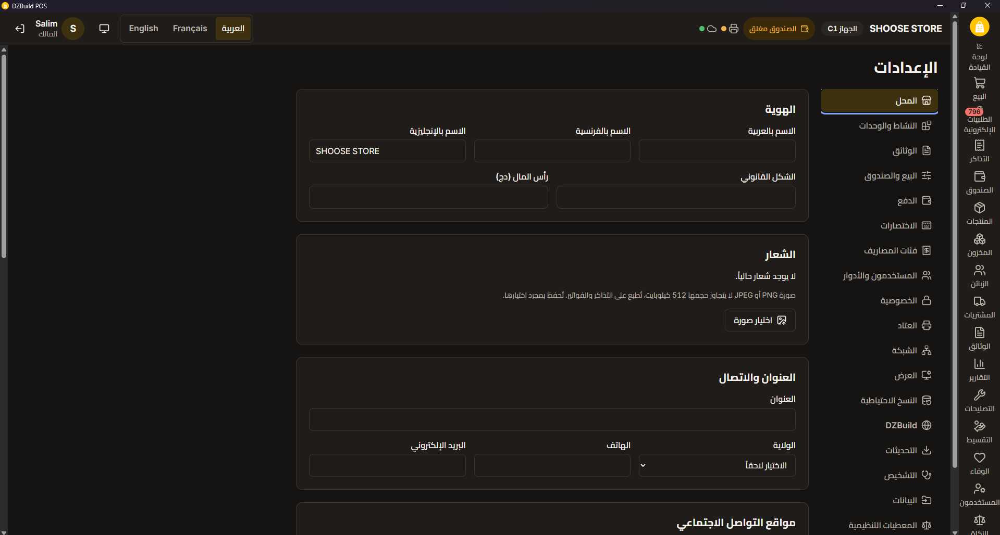

<p align="center">
  <b>English</b> · <a href="README.fr.md">Français</a> · <a href="README.ar.md">العربية</a>
</p>

<p align="center">
  <picture>
    <source media="(prefers-color-scheme: dark)" srcset="assets/brand/dzbuild-pos-logo-horizontal-on-dark.png">
    
  </picture>
</p>

<h3 align="center">Free point of sale and stock management for Algerian shops. Works offline.</h3>

<p align="center">
  <a href="https://github.com/DZBuild-com/dzbuild-pos/actions/workflows/ci.yml"></a>
  <a href="https://github.com/DZBuild-com/dzbuild-pos/releases"></a>
  <a href="LICENSE"></a>
  
  
</p>

<p align="center">
  
</p>

DZBuild POS is a Windows desktop application for shops in Algeria. It handles the till, stock,
customer credit (kridi), suppliers and the invoices required by Algerian law. The interface and the
printed documents are available in Arabic, French and English. It runs without an internet
connection and without a subscription.

## Download

Download the setup from [dzbuild.com/pos](https://dzbuild.com/pos). Each tagged version is also on
[GitHub Releases](https://github.com/DZBuild-com/dzbuild-pos/releases).

| Setup | Use it for |
| --- | --- |
| 64-bit setup | Most PCs (Windows 10 or 11, 64-bit). Installs WebView2 if it is missing. |
| 32-bit setup | Older PCs running 32-bit Windows 10. |
| Offline setup (64-bit or 32-bit) | PCs without internet. It includes WebView2 and can be copied to a USB stick. |

Each release includes a `SHA256SUMS.txt` file to check the download.

> [!NOTE]
> The setups are not code-signed yet, so Windows SmartScreen may show "Windows protected your PC".
> Click **More info**, then **Run anyway**, only if the file came from dzbuild.com/pos or from this
> repository and its SHA-256 matches `SHA256SUMS.txt`.

## Why it is free

DZBuild POS is made by DZBuild, which also runs the [DZBuild](https://dzbuild.com) online store
platform. The POS is free: no licence key, no subscription, no account. All features work offline.

A shop that also sells online can link the POS to a DZBuild store to share its catalogue and stock
and receive online orders at the till. The link is optional and nothing in the POS depends on it.

The source still contains a licence module (`crates/pos-license`). It is turned off by `free = true`
in `src-tauri/license.toml`.

## Features

| Area | What it does |
| --- | --- |
| Till | Keyboard and barcode-scanner sale screen, split payments, stamp duty (droit de timbre) and change calculated as you go, held tickets, returns and exchanges, cash sessions from opening float to Z report. |
| Stock | Append-only movement ledger, stock counts with the scanner (blind or not), transfers between locations, lots and expiry dates (FEFO), serial numbers and IMEI, weighted average cost (CMUP). |
| Customers and kridi | Credit sales with a limit and manager approval above it, payments on account with a numbered receipt, statements, ageing, store credit, loyalty points and vouchers. |
| Suppliers and purchases | Purchase orders, partial goods receipts, supplier invoices and payments, supplier returns, statements. |
| Documents and tax | Quotes, proformas, delivery notes, invoices and credit notes with gap-free numbering and the mentions required by décret 05-468. Hash-chained audit journal. 60 reports, including VAT, stamp duty, a G50 helper and the sales and purchase registers. Fiscal archive with a SHA-256 manifest and a verifier. |
| Printing and hardware | ESC/POS receipt printers (Arabic is printed as an image), A4 and A5 invoices and PDF, TSPL and ZPL label printers, serial scales and weight barcodes, cash drawer, pole display, customer screen on a second monitor. |
| Several tills | One main PC and several tills on the shop network, no internet needed. A till keeps selling if the network or the main PC goes down, and sends its sales when the connection returns. |
| Import and export | Excel (xlsx, xls, ods) and CSV in UTF-8 or the older Windows Arabic and French encodings, with a preview before import. Lists export to xlsx and csv. A full backup file moves a shop to another PC. |
| Trade templates | 25 activity templates chosen at setup, such as restaurant, pharmacy, butcher, phone repair, wholesale and jewellery. |
| Languages | Arabic (right to left), French and English for screens and printed documents. Each user picks a language, and each customer can receive documents in their own. |
| Backups and updates | Automatic rotating backups, a second copy and USB copies, an integrity check and a guided restore. Updates are signed and install only when every cash drawer is closed. |

### What it will not do

DZBuild POS does not and will not offer fictive invoices, hidden or "non-billable" stock, or deletion
of sales. These practices are illegal in Algeria. A validated document cannot be edited. It is
corrected with a credit note or a return, and every change is recorded in the audit journal.

## Requirements

| | |
| --- | --- |
| System | Windows 10 (version 1809 or later) or Windows 11, 64-bit or 32-bit |
| Runtime | Microsoft Edge WebView2 (included in Windows 11 and in the offline setup) |
| Hardware | The reference machine is a shop PC with 4 GB of RAM |
| Network | Not needed to sell. A local network only for several tills. Internet only for updates and the optional DZBuild link |

## Build from source

You need:

| Tool | Version |
| --- | --- |
| Windows | 10 (1809 or later) or 11 |
| [Rust](https://rustup.rs) | stable, 1.95 or later (set by [`rust-toolchain.toml`](rust-toolchain.toml)) |
| [Visual Studio Build Tools](https://visualstudio.microsoft.com/visual-cpp-build-tools/) | 2022, with "Desktop development with C++" |
| [Node.js](https://nodejs.org) | 22.12 or later (CI uses 24) |
| [pnpm](https://pnpm.io) | the version in `package.json` (`corepack enable` installs it) |
| WebView2 | Evergreen runtime (already on Windows 11) |

```powershell
pnpm install                      # install dependencies
pnpm tauri dev                    # run the app in development mode
pnpm check                        # run the same checks as CI
pnpm release:build                # build the 64-bit setups into dist-release/<version>/
pnpm release:build --arch x86     # build the 32-bit setups (run "rustup target add i686-pc-windows-msvc" once)
```

Development data is stored in `%APPDATA%\dev.dzbuild.pos\`. See [CONTRIBUTING.md](CONTRIBUTING.md)
for tests and code rules, and [`docs/release/RELEASING.md`](docs/release/RELEASING.md) for releases.

## Project layout

The core is written in Rust on top of SQLite. [Tauri 2](https://tauri.app) provides the desktop
shell, and the interface is React 19 with TypeScript. The interface has no SQL access: it calls typed
commands.

| Path | Contents |
| --- | --- |
| [`crates/pos-core`](crates/pos-core) | Business logic and database: money in integer centimes, tax, stock ledger, kridi, cash, audit journal, migrations. No Tauri dependency. |
| [`crates/pos-docs`](crates/pos-docs) | Receipts and invoices, amounts in words, xlsx and csv import and export, document wording in three languages. |
| [`crates/pos-hw`](crates/pos-hw) | ESC/POS, Arabic raster printing, labels, scales, cash drawer, pole display. |
| [`crates/pos-server`](crates/pos-server) | Main PC role for several tills (HTTP, WebSocket, mDNS discovery). |
| [`crates/pos-license`](crates/pos-license) | Offline licence check, turned off in the free edition. |
| [`src-tauri`](src-tauri) | Desktop shell: commands, windows, updater, installer. |
| [`src`](src) | React interface. Strings are in `src/locales/{ar,fr,en}`. |

[`docs/STACK.md`](docs/STACK.md) summarises the architecture.
[`docs/01-MASTER-FEATURE-SPEC.md`](docs/01-MASTER-FEATURE-SPEC.md) is the feature specification,
including the list of features that must never be built.

## Contributing

The project is maintained by the DZBuild team. Code, translations, documentation and hardware test reports are all welcome. Read
[CONTRIBUTING.md](CONTRIBUTING.md) first. Issues labelled
[good first issue](https://github.com/DZBuild-com/dzbuild-pos/labels/good%20first%20issue) are a
good place to start. Questions go to
[Discussions](https://github.com/DZBuild-com/dzbuild-pos/discussions). Everyone taking part follows
the [Code of Conduct](CODE_OF_CONDUCT.md).

## Security

Do not open a public issue for a vulnerability. [SECURITY.md](SECURITY.md) explains how to report it
privately.

## Localisation

Arabic, French and English have the same status. Every interface string is a key in
`src/locales/{ar,fr,en}/*.json`. Words printed on documents are in `crates/pos-docs/locales/`.
[`src/locales/GLOSSARY.md`](src/locales/GLOSSARY.md) lists the business terms. To fix a wording, open
a [translation issue](https://github.com/DZBuild-com/dzbuild-pos/issues/new?template=translation.yml)
or a pull request.

## Licence

DZBuild POS is free software, released under the
[GNU General Public License, version 3 or later](LICENSE).

The names "DZBuild" and "DZBuild POS" and the logo are trademarks of DZBuild and are not covered by
the licence. See [TRADEMARKS.md](TRADEMARKS.md).

## Links

- Download: [dzbuild.com/pos](https://dzbuild.com/pos)
- Help for shops: [dzbuild.com/pos/support](https://dzbuild.com/pos/support)
- Blog: [blog.dzbuild.com](https://blog.dzbuild.com)
- Open a DZBuild online store: [dzbuild.com/register](https://dzbuild.com/register)
- Changes in each version: [CHANGELOG.md](CHANGELOG.md)
